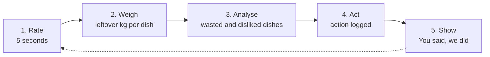
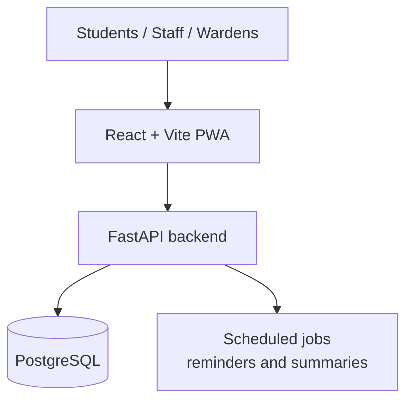

# MessPulse.MNX
Student-first web app that turns hostel mess ratings, skipped meals and measured leftovers into less food waste and better meals. React + FastAPI + PostgreSQL.

# MessPulse

**A student-first web app that turns hostel mess ratings, skipped meals and measured leftovers into less food waste and better meals.**

> **Status: Full End-to-End Implementation & QA Integration Audit Complete (100% Verified).**  
> The application features a futuristic Olive Green & Crystalline White Spatial UI, a high-performance FastAPI backend, Alembic database migrations, offline-capable PWA service worker, and a verified automated QA test suite.

---

## The problem

Hostel and college messes cook for an unpredictable number of students. As a result:

- **Demand is guessed.** Kitchens often cook for a full house, so surplus is routine.
- **Feedback goes nowhere.** Ratings and complaints end up in registers, forms and emails, and students rarely see anything change.
- **Waste is estimated, not measured.** Without weighing leftovers per dish, nobody can say which dish is the problem.
- **Participation is hard.** If rating takes a long form or an approval step, most students never do it.

## The solution

MessPulse connects students, mess staff and wardens in one lightweight web app:

1. **Students** open a QR link, rate a meal in about five seconds, and can skip a meal before a cut-off.
2. **Mess staff** enter headcount and leftover kilograms per dish on one simple screen.
3. **The platform** shows which dishes are wasted or disliked and estimates expected headcount.
4. **Wardens** log actions, and students see them in a public **"You said, we did"** list.



## Who it is for

| Audience | What they get |
|---|---|
| Hostel students | One-tap rating, skip-a-meal, a visible waste meter, proof that feedback matters |
| Mess staff and cooks | Real numbers to cook against, one-screen daily entry |
| Wardens and administrators | Waste and ratings dashboards, an action tracker, weekly summaries |
| Caterers | Dish-level trends that show which changes worked |

## Features

**MVP (first release)**
- Today's menu, one-tap meal rating, skip-a-meal with a cut-off
- Staff daily entry: headcount and leftover kg per dish, menu editor
- Expected headcount per meal
- Waste and ratings dashboards (ratings shown only after a minimum sample size)
- Action tracker and the public "You said, we did" log
- Role-based access: student, staff, warden, admin
- Built-in quick tour for first-time users and an in-app user guide

**Later (after pilot validation)**
- Cooking-quantity guide, offline-tolerant staff entry, meal reminders
- Hindi and Odia interface text, exports, personal "my impact" page
- Optional surplus-food directory (NGO contacts)

## How it differs from existing tools

Existing platforms (for example SpaceBasic, MealPe, Digii and the open-source MessWala) already cover attendance, billing and inventory. MessPulse focuses on gaps that, from public material, look under-served: **measured waste per dish**, a **closed feedback loop**, **very low student friction**, and **easy adoption by a single hostel**. These gaps are hypotheses to be validated in a pilot. Details and sources are in the project document.

## Architecture



| Layer | Choice |
|---|---|
| Frontend | React with Vite, installable PWA |
| Backend | Python, FastAPI |
| Database | PostgreSQL |
| Auth | JWT sessions, role-based access, optional Google sign-in |
| Hosting (pilot) | Free tiers of a static host, an app host and a managed database (verify current limits) |

**Privacy by design:** ratings are anonymous and shown only as aggregates, no phone numbers or precise locations are collected, and secrets are kept in environment variables.

## Planned project structure

```text
messpulse/
  backend/        FastAPI app (routers, models, schemas, services, tests)
  frontend/       React + Vite PWA (pages, components, tour, help content)
  docs/           Project documentation and API reference
  README.md
  LICENSE
```

## Getting Started

### 1. Backend Setup
```bash
cd backend
python -m venv venv
# On Windows:
venv\Scripts\activate
# On Linux/macOS:
source venv/bin/activate

pip install -r requirements.txt
alembic upgrade head
python -m app.db.seed
uvicorn app.main:app --reload --port 8000
```
Backend API interactive documentation is available at `http://127.0.0.1:8000/docs`.

### 2. Frontend Setup
```bash
cd frontend
npm install
npm run dev
```
The application runs at `http://127.0.0.1:5173`.

---

## 🚀 Deploying to Render (Permanent Live Prototype)

MessPulse is pre-configured for permanent deployment on [Render](https://render.com/).

### Option A: 1-Click Blueprint (Frontend + Backend)
1. In [Render Dashboard](https://dashboard.render.com/), click **New +** > **Blueprint**.
2. Connect this repository (`mausamkumarnayak-a11y/MessPulse.MNX`).
3. Render automatically detects [`render.yaml`](render.yaml) and provisions:
   - **`messpulse-frontend`**: Static Site (Global CDN, 100% free, 24/7 uptime, zero spin-down sleep).
   - **`messpulse-backend`**: FastAPI Web Service (Python 3.11 with SQLite and automatic demo data seeding).
4. Click **Apply**. Render will build and deploy both services!

### Option B: Deploy Static Site Frontend Only (Instant & 100% Free)
1. On Render, click **New +** > **Static Site**.
2. Connect your GitHub repository.
3. Configure the fields:
   - **Name**: `messpulse`
   - **Root Directory**: `frontend`
   - **Build Command**: `npm run build`
   - **Publish Directory**: `dist`
4. Click **Create Static Site**. Your live URL will be ready in under 60 seconds!

### 📦 Classic Olive Version Archive
The original olive green interface is preserved permanently in this repository:
- Git Tag: `v1.0.0-classic`
- Git Branch: `backup/classic-olive`

### 3. Running the QA Integration Test Suite
```bash
# Backend pytest suite (9 tests covering auth, RBAC, rating gate, skips cutoff)
cd backend
venv\Scripts\pytest.exe -v

# Frontend TypeScript check and production bundle verification
cd ../frontend
npm.cmd run build

# End-to-end multi-persona live API audit
cd ..
backend\venv\Scripts\python.exe test_audit_suite.py
```
For complete test results and criteria verification, see [docs/audit-report.md](docs/audit-report.md).


## Roadmap

| Phase | When | Deliverable |
|---|---|---|
| 0. Validate | Week 0 | Interviews with students and mess staff |
| 1. Foundation | Weeks 1-2 | Database, sign-in and roles, student menu, rating and skip |
| 2. Kitchen side | Weeks 3-4 | Staff daily entry, menu editor, expected headcount |
| 3. Insights and loop | Weeks 5-6 | Dashboards, action tracker, tour and user guide |
| 4. Pilot | Weeks 7-10 | Run in one mess and measure results |
| 5. Decide | Week 11 | Review results and plan V2 |

## Documentation

The full project document (problem, audience, existing solutions, gap analysis, features, architecture, UX, testing, business model canvas, roadmap, risks) is in messpulse documentation pdf:- (https://drive.google.com/file/d/1es6_n5Mzo7_fbo_6N5lmdHWkL2iiC2KH/view?usp=drive_link).

## Contributing

Contributions are welcome once the first milestone is in place. Good first areas: user-guide content, accessibility checks, tour copy, and translations. Please open an issue to discuss a change before sending a pull request.

## Limitations

- No pilot has been run, so there are no measured results yet.
- Competitor information comes from public web pages, which are partly marketing material.
- Hosting free tiers, costs and legal requirements (for example data protection for student data) need to be checked before any public launch.

## Author

**Mausam Kumar Nayak**
