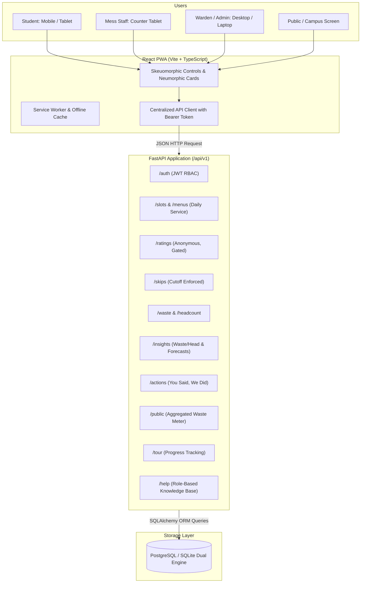
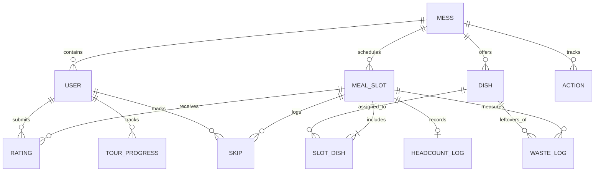

# MessPulse System Architecture Documentation

## 1. High-Level Architecture
MessPulse uses a decoupled client-server architecture:
- **Client (Frontend)**: React 19 + TypeScript + Vite, packaged as an installable Progressive Web App (PWA). Employs modern sensory design (skeuomorphic tactile controls, neumorphic soft containers, glassmorphic floating overlays and modals) in a calm olive-green/warm amber palette.
- **Server (Backend)**: Python FastAPI application structured by domain routers (`auth`, `slots`, `ratings`, `skips`, `waste`, `insights`, `actions`, `help`, `tour`).
- **Database (Persistence)**: Relational database managed with SQLAlchemy 2.0 ORM and Alembic migrations. Works natively with PostgreSQL (production/Docker) and SQLite (zero-friction standalone development/testing).

## 2. Core Entities & Relationships

## 3. Privacy by Design Enforcement
1. **Student Anonymity**: When a student submits a rating, `user_id` is recorded solely to enforce the unique constraint (one rating per student per meal slot).
2. **Identity Protection**: No staff or warden endpoint ever serializes or returns `user_id`, student names, or student identifiers alongside ratings.
3. **Rating Gate (Minimum Sample Size)**: Average dish scores and sentiment breakdowns are hidden and return a status of `insufficient_sample` until at least 5 distinct students have submitted ratings for that slot/dish.

## 4. Key Calculation Formulas
- **Waste Per Head (kg/person)**:
  $$\text{Waste Per Head} = \frac{\sum \text{leftover\_kg of all dishes for slot}}{\text{headcount\_served}}$$
- **Expected Headcount**:
  $$\text{Expected Headcount} = (\text{Registered Students} - \text{On-Time Skips}) \times \text{Historical Show-Up Rate}$$
  *(Historical show-up rate is calculated for the same weekday and meal type).*
